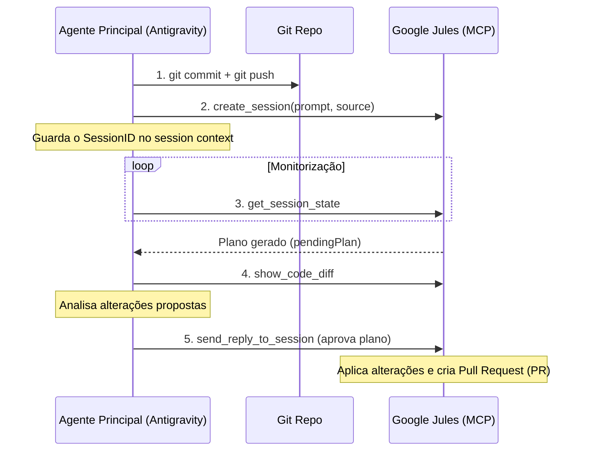

# Jules Copilot Skill

Esta skill orienta o agente principal sobre como delegar tarefas de desenvolvimento assíncronas na nuvem ao **Google Jules** utilizando Model Context Protocol (MCP).

## 1. Regras Críticas de Execução & Sincronização

> [!IMPORTANT]
> O Jules opera em repositórios remotos clonados no Google Cloud Platform. Ele **NÃO** tem acesso direto às suas modificações locais ainda não submetidas.

* **Sincronização Obrigatória**: Antes de iniciar qualquer tarefa no Jules, verifique o estado do git local. Faça *commit* de todas as alterações relevantes e execute `git push` para garantir que o Jules analisa a versão correta do código.
* **Aprovação de Plano (Human-in-the-loop)**: Nunca aprove um `pendingPlan` sem antes rever o diff. Nunca execute tarefas totalmente autónomas sem validação manual ou do próprio agente principal.
* **Segurança de Credentials**: O servidor oficial `@google/jules-mcp` é autenticado via `JULES_API_KEY`, carregada do `~/Dev/.env`. Nunca exponha estes valores nos logs ou no código fonte.

## 2. Ferramentas Expostas

O Jules é acedido através do servidor MCP `jules` (pacote oficial `@google/jules-mcp`):

### Consulta (Read-Only)
* `list_sessions`: Lista sessões recentes, com paginação opcional.
* `get_session_state`: Estado da sessão — `status` (busy/stable/failed), `prompt` original, `lastActivity`, `lastAgentMessage` e `pendingPlan` (plano a aguardar aprovação, com steps).
* `get_code_review_context`: Resumo das alterações da sessão com lista de ficheiros e metadados.
* `show_code_diff`: Patch unificado (unidiff) completo das alterações geradas.
* `query_cache`: Consulta a cache local de sessões e actividades usando JQL.

### Acções
* `create_session`: Inicia um desenvolvimento assíncrono.
  * Argumentos obrigatórios: `prompt` (instrução detalhada), `source` (repositório no formato `sources/github/owner/repo`).
  * Argumentos recomendados: indicar a branch de destino (ex.: `main`) no próprio prompt.
* `send_reply_to_session`: Envia uma mensagem/feedback à sessão ou aprova o plano pendente.

---

## 3. Fluxo de Trabalho (Handoff e Monitorização)

### Handoff de Contexto Recomendado
Ao criar a tarefa, inclua no prompt do Jules:
1. Caminho absoluto dos ficheiros que necessitam de intervenção direta.
2. Limites arquiteturais (o que não deve ser alterado).
3. Regras de estilo de código a respeitar.

---

## 4. Diretrizes de Qualidade & Controlo

### Anti-Patterns / O que evitar
* **Never** delegate tasks to Jules without pushing local git tree modifications first.
* **Do not** approve a `pendingPlan` via `send_reply_to_session` without reviewing `show_code_diff` first, to prevent unverified Pull Request pushes.
* **Avoid** running tasks on top of outdated or untested branch bases.

### Loop de Validação / Feedback Loop
1. Execute `get_session_state` to monitor plan generation and check status.
2. Run local tests on the resulting Pull Request branch; if tests fail, submit feedback via `send_reply_to_session` and re-run until clean.
